## Hi there, my name is Marcos. :)
I'm a Computer Engineering student at the EHU.

---

## I work with:
### OS

    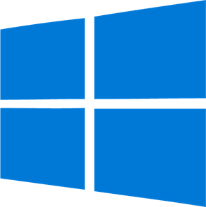
    
    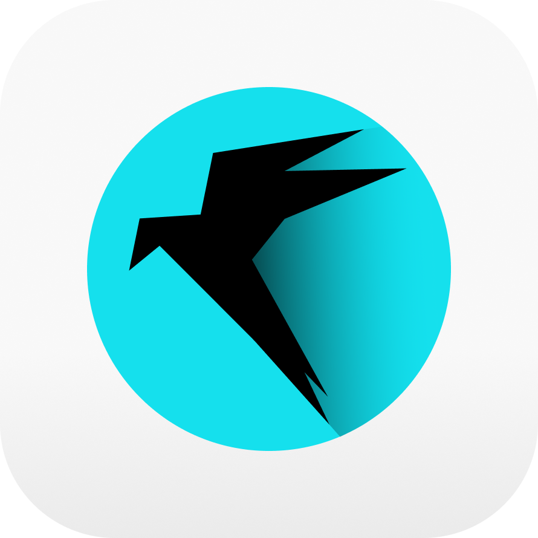

### IDE

    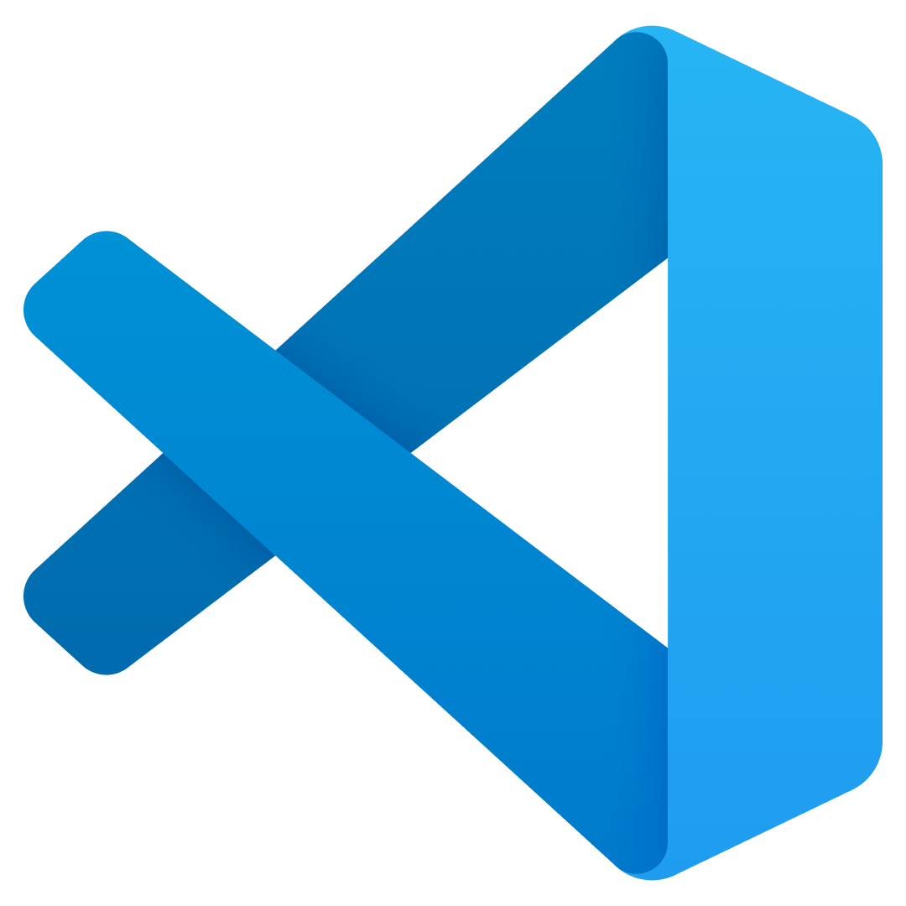
    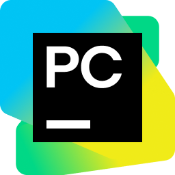
    
    

### System Administration

    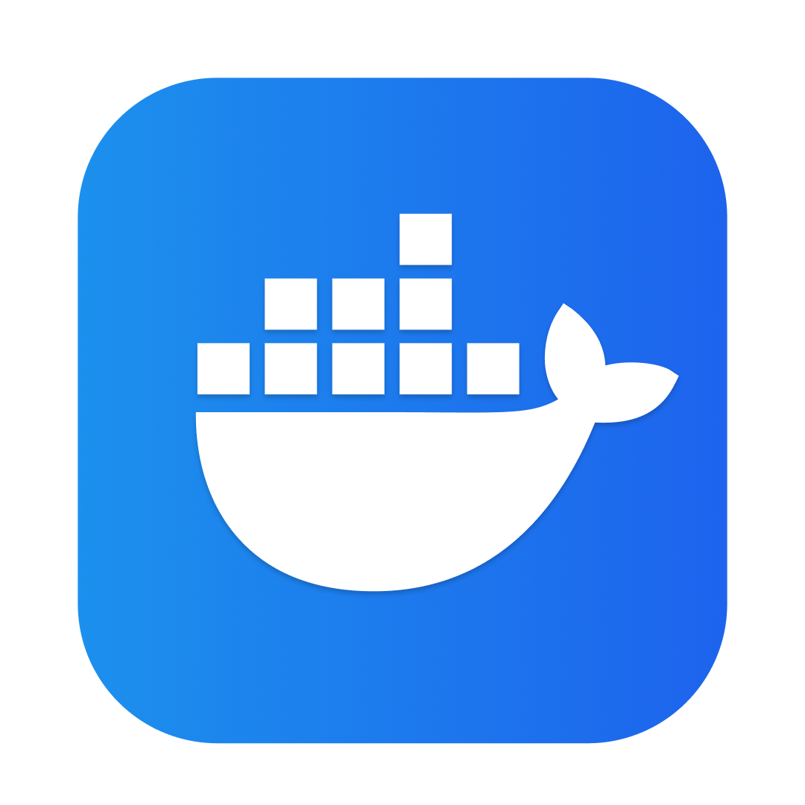
    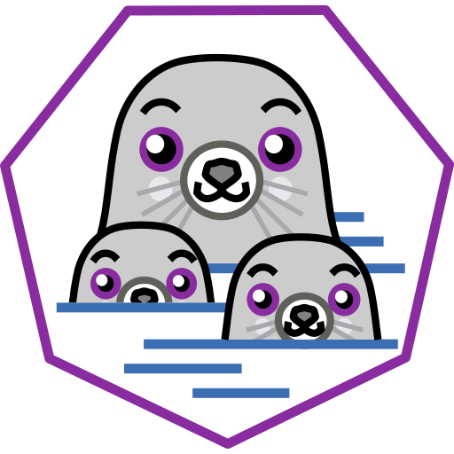
    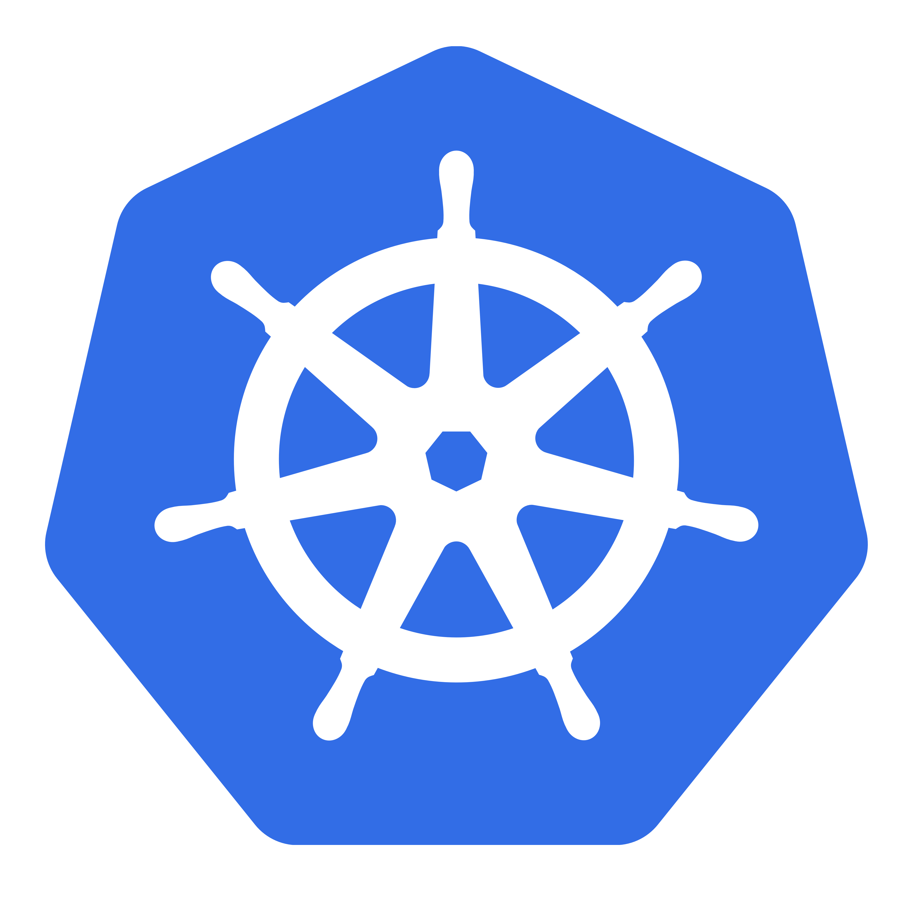
    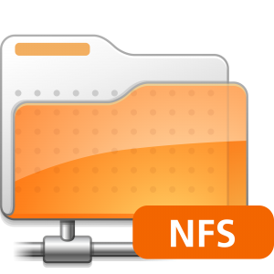
    
    

### Database

    
    
    
    

### Cybersecurity

    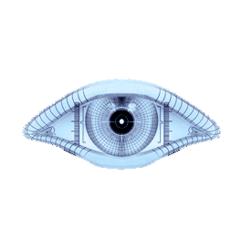
    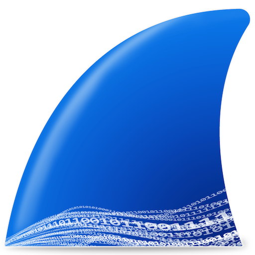
    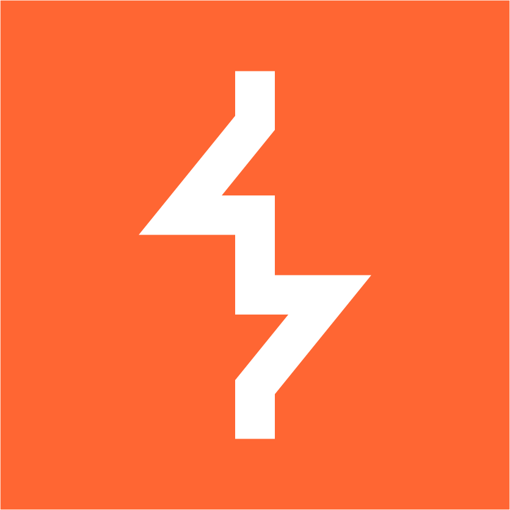
    

